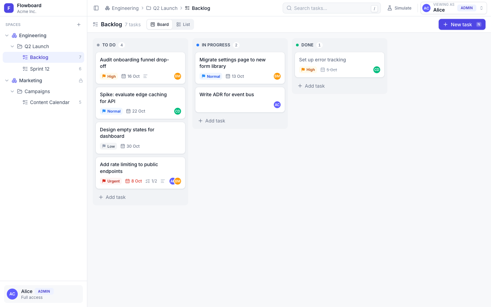
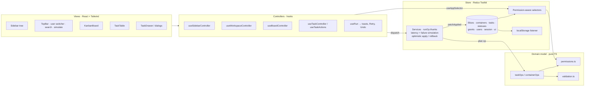

# Flowboard

A mini project-management app for one team workspace. It has a Workspace → Space → Folder → List → Task hierarchy, a kanban board, a list view, a task drawer, and a simple permission model with an in-app user switcher.

There is no backend. Everything runs in a typed Redux Toolkit store that is seeded from fixtures and persisted to `localStorage`.



---

## 1. Run it locally

Requires **Node 20.19+ or 22.12+** (Vite 8). Tested with Node 23 and npm 10.

```bash
npm install
npm run dev        # http://localhost:5173
```

| Script | What it does |
| --- | --- |
| `npm run dev` | Vite dev server |
| `npm run build` | Type-check (`tsc -b`) + production build |
| `npm run typecheck` | Type-check only |
| `npm test` | Vitest: unit, store and component tests (jsdom) |
| `npm run lint` | oxlint |
| `npm run preview` | Serve the production build |

Data persists in `localStorage` (key `flowboard:v1`). To return to the seed state, open the **user switcher → Reset demo data**.

## 2. Architecture

The code is organised in three layers, so that business rules live outside the UI.

```
src/
├── models/        M — pure TypeScript, no React, no Redux
│   ├── types.ts           entities, Result<T>, AppError, Patch
│   ├── permissions.ts     visibility resolution, access checks, visible tree
│   ├── validation.ts      field rules, parent-type rules, status ∈ list
│   ├── taskOps.ts         plan{Create,Update,Move,Delete,Restore}Task → Patch
│   ├── containerOps.ts    plan{Create,Rename,Reorder,Archive,Restore,…} → Patch
│   ├── ordering.ts        dense positions, sort comparators
│   └── seed.ts            fixtures
├── store/         M — Redux Toolkit
│   ├── slices/            containers, tasks, statuses, grants, users, session, ui
│   ├── services/          the client-side "API": runOp + task/container/load thunks
│   ├── selectors.ts       memoized, permission-aware reads
│   └── persistence.ts     listener middleware → localStorage
├── controllers/   C — hooks that connect views to the store; UI feedback (toasts, save state)
└── views/         V — presentational React components (Tailwind only)
    ├── layout/  (AppShell, TopBar, Sidebar tree, dialogs, user switcher, simulation)
    ├── board/   (KanbanBoard, KanbanColumn, TaskCard, QuickAdd)
    ├── list/    (TaskTable)
    ├── task/    (TaskDrawer, editors, fields, NewTaskDialog)
    └── common/  (Button, Avatar, Badges, Modal, Skeletons, States, Toaster, style tokens)
```



### How a mutation flows

Every write goes through `store/services/runOp.ts`:

1. **Plan.** A pure domain function such as `planMoveTask(snapshot, user, input, ctx)` checks permissions and validation, then returns `{ data: { patch, value } }` or `{ error: { code, message, status } }`. It never mutates anything.
2. **Simulate the network.** It waits for the configured latency and may fail at random (`NETWORK`, 503) when failure simulation is on.
3. **Apply.** One generic `patchApplied` action upserts or removes entities, so reducers stay simple.
   - **Non-optimistic** ops re-run the plan against the latest state after the "request". This catches changes made while the request was in flight, such as access being revoked.
   - **Optimistic** ops (kanban drag, sidebar reorder) apply first, keep an inverted patch, and roll back if the request fails.
4. **Respond.** The result is always `Result<T>` and never throws. The controller's `useRun` turns errors into toasts (with **Retry** for network errors) and can show success toasts (with **Undo** for delete and archive).

Views never dispatch mutations directly. They call controller functions.

---

## 3. Data model

```ts
Container { id, name, type: 'workspace'|'space'|'folder'|'list', parentId, position, visibility: 'public'|'private', archivedAt }
Status    { id, listId, name, category: 'todo'|'in_progress'|'done', color, position }
Task      { id, listId /* primaryListId */, parentTaskId, title, description, statusId, priority,
            assigneeIds, dueDate, position, createdAt, updatedAt, deletedAt }
User      { id, name, email, role: 'admin'|'member', color }
Grant     { id, resourceId, userId, mode: 'allow'|'deny' }
```

- **Normalized tables.** Each entity type lives in its own slice as `Record<id, entity>`. Domain rules read from a `Snapshot` of all tables.
- **Hierarchy.** Parent types are strict: workspace → space → folder → list. Lists hold tasks, never containers. Siblings are ordered by a dense `position` (0..n-1), which is reindexed on every change.
- **Statuses** belong to a list. New lists get *To do / In progress / Done*. The seed shows custom sets: Sprint 12 adds *In review*, and Content Calendar uses *Idea / Drafting / Published*. A task's status must belong to its list.
- **Task position** is the order within its status column. A subtask's position is the order within its parent.
- **Subtasks** (stretch within MVP) are one level deep (`parentTaskId`). They live in the parent's list, appear as a progress count on cards, and are managed in the drawer.
- **Soft delete and archive.**
  - Containers are **archived** (`archivedAt`). Only the archived node is stamped; its descendants are hidden through the ancestor chain, so a restore brings the whole subtree back unchanged. Admins restore from **Archived** in the sidebar.
  - Tasks are **soft-deleted** (`deletedAt`) together with their subtasks, with an **Undo** toast.
- **Seed:** 1 workspace, 2 spaces, 2 folders, 3 lists, 18 tasks plus 2 subtasks, 3 users, 2 grants. Due dates are relative to "today", so overdue, today and upcoming states always appear.

---

## 4. Permissions: how they're enforced

**Rules** (`models/permissions.ts`):

- **Admins** bypass every check.
- **Members** resolve visibility top-down from the workspace root:
  - A `deny` grant on a node or any ancestor hides the whole subtree. Deny wins.
  - An `allow` grant is inherited by all descendants.
  - A **private** node is visible only with an inherited or direct `allow`. A **public** node is visible unless denied.
- **Archived** subtrees are hidden for everyone in normal views.
- Members can **view and edit tasks** in any list they can see. **Container management** (create, rename, reorder, archive, visibility, grants) is admin-only.

**Seed grants:**

| User | Role | Grants | Sees |
| --- | --- | --- | --- |
| Alice | admin | — | everything |
| Bob | member | `deny` on Sprint 12 | Engineering → Q2 Launch → Backlog |
| Carol | member | `allow` on Marketing (private) | everything |

**Where the checks run.** They live in the model and store, not only in the UI:

- **Reads:** every selector (`selectVisibleTree`, `selectBoardColumns`, `selectListRows`, `selectTaskAccess`, `selectVisibleLists`, …) filters through the same functions. A hidden list returns no columns, no rows, and no task.
- **Writes:** every `plan*` op starts with an access check and returns `{ error: { code: 'FORBIDDEN', message, status: 403 } }`.
  - Moving a task into a list you can't see is also a 403.
  - Non-optimistic ops are re-checked after the simulated request, so access revoked mid-flight still fails.
- **UI:** admin-only controls are hidden for members as a convenience, not as the protection. Opening a denied list shows a 403 state. Because access is derived live, switching users updates the tree and the open board immediately. The task drawer shows a 403 if the task becomes inaccessible.

**How I'd extend the model:**

1. **Teams and groups.** Add `subject: { type: 'user' | 'team', id }` to grants and expand a user to `[userId, ...teamIds]` when resolving. Keep the rule that the most specific (closest-to-node) grant applies and that `deny` beats `allow` at the same level.
2. **Capabilities instead of booleans.** Use `mode: 'deny' | 'view' | 'comment' | 'edit' | 'manage'` and resolve the *maximum* capability along the chain. This would let some members view without editing, and let a "space admin" manage containers.
3. **Caching.** Precompute an access map (`Map<containerId, Capability>`) per user when grants or containers change, instead of walking ancestors on each check.
4. **Server.** The same `plan*` functions map one-to-one onto API handlers. The client would keep its checks only for UX, and the server would become the source of truth.

---

## 5. Data integrity and edge cases

| Situation | Behavior |
| --- | --- |
| Invalid parent (list in a space, folder in a list, unknown or archived parent) | `INVALID_PARENT` |
| Duplicate sibling name (case-insensitive, ignoring archived siblings) | `CONFLICT` shown inline in the create dialog |
| Task status from another list | `INVALID_STATUS` |
| Empty title or title over 500 characters, unknown assignee, bad date | `VALIDATION`, with inline messages and a character counter in the UI |
| Task moved to another list | Status is remapped by category (in_progress → that list's first in_progress status, otherwise the first status). The task goes to the end of the column. Subtasks move with it. |
| Subtask moved to another list on its own | Rejected: subtasks move with their parent |
| Subtask of a subtask, or subtask in a different list | Rejected (max depth 1) |
| Deleting a parent task | Its subtasks are soft-deleted too; Undo restores them together |
| Restoring a subtask whose parent is deleted | Rejected: restore the parent first |
| Archiving a space or folder | The whole subtree and its tasks are hidden, and all task operations inside it return 404 |
| Restoring under an archived parent | `INVALID_PARENT` ("Restore X first") |
| Stale edit (task changed since it was read) | `CONFLICT` (409). Drawer edits are queued and each one sends the version current when it's sent, so rapid edits never conflict with each other. |
| Simulated network failure | Optimistic ops roll back; others are not applied. A toast offers Retry. |
| Two lists opened in quick succession | A load token ignores the stale response |
| Re-parenting containers by drag | Not supported (siblings only), by design |

Every error has the same shape: `{ error: { code, message, status } }`.

---

## 6. UX notes

- **Loading:** skeletons for the tree, board and table on first load and whenever a list is opened (simulated latency).
- **Empty states:** empty list (with a create action), empty columns ("No tasks", or "Drop here" while dragging), no search matches, and a member with nothing shared.
- **Errors:**
  - Toasts for failed mutations, including Retry on network failures.
  - Full-page 403, 404 and network states with recovery actions.
  - Inline form errors.
- **Feedback:**
  - Hover, focus-visible and active states on tree rows, cards, rows and buttons.
  - "Saving… / Saved / Not saved" in the drawer.
  - Success toasts with Undo for delete and archive.
- **Drag and drop:**
  - A tilted drag preview with a shadow, a dashed placeholder, and a highlighted target column.
  - Status and position persist after a drop.
  - A failed move shakes the card back into place.
  - Keyboard drag is supported: Space to pick up, arrow keys to move.
- **Task drawer:**
  - Slides in from the right. Escape and overlay click close it, focus is trapped and returned to the card.
  - The title is edited inline: Enter saves; Escape reverts the edit without closing the drawer.
  - Property grid, description, subtasks with a segmented progress bar, and created/updated metadata.
  - A subtask's drawer has a **← Back** button to its main task.
  - The due date uses a custom Tailwind date picker built on a Headless UI Popover, with no date library. The browser's native `<input type="date">` can't be styled. It offers:
    - quick picks (Today, Tomorrow, Next week, Clear)
    - month navigation
    - highlighted today and selected day
    - keyboard navigation: arrow keys, PageUp/PageDown for months, Home/End for the week
- **Cards:** title, priority badge, due date (red when overdue, amber today or tomorrow), subtask progress, description indicator, and assignee avatars. A hover lift reveals a quick menu: open, move to status, priority, delete.
- **Consistency:** status and priority colors come from one map (`views/common/styles.ts`), so cards, rows, the drawer and selects always match.
- **Keyboard shortcuts:** `N` new task, `/` search, `B` / `L` switch view, `[` toggle sidebar, `?` show help.

---

## 7. Styling: Tailwind only

- Every style is a utility class in JSX. There are no CSS modules, styled-components or custom stylesheets. `src/index.css` contains only the Tailwind entry: `@import "tailwindcss"` and `@config`.
- `tailwind.config.ts` defines a small token set:
  - `colors`: canvas, surface, ink, line, brand, danger, success, warning, priority
  - `fontFamily`: Inter
  - `borderRadius`: card, control, pill
  - `boxShadow`: card, card-hover, drag, popover, drawer
  - two keyframes: toast-in and shake
- Headless UI (Dialog, Menu, Listbox, Popover, Switch, RadioGroup) is used for accessible primitives and is styled entirely with Tailwind.
- Icons come from `lucide-react`.

**`style=` exceptions (drag and drop only):**

| Where | Why |
| --- | --- |
| `views/board/TaskCard.tsx` (`SortableTaskCard`) | dnd-kit's `transform` and `transition` for sortable items |
| `views/layout/sidebar/TreeItem.tsx` | The same, for sibling reordering in the tree |

Library-managed inline positioning, which our code never writes: dnd-kit's `DragOverlay` and Headless UI's anchored panels (floating-ui) set their own `top`/`left`/`transform`.

---

## 8. Tests

`npm test` runs 48 tests. Each test builds a **fresh store** (`makeStore()`) with zero latency and no persistence, so tests are isolated.

| File | Covers |
| --- | --- |
| `models/permissions.test.ts` | Visible tree per user, deny-wins inheritance, private plus allow, archived pruning, 403 vs 404 for lists and tasks |
| `store/store.test.ts` | Selectors per user, 403s on every mutation type, admin-only container ops, grant changes taking effect, validation (title, status, assignees), stale `CONFLICT`, reorder and cross-column moves with dense positions, cross-list moves with status remap and subtasks, depth limit, soft delete with undo, parent-type rules, duplicate names, archive and restore ordering, optimistic rollback, non-optimistic failure, permission revoked mid-request |
| `test/app.test.tsx` | Component tests with Testing Library: user switch updates the tree, 403 view after switching, quick-add on the board (shows a success toast and closes the composer), list sorting, drawer edit with "Saved" then Escape closes, subtask → parent Back navigation, date picker (quick pick, keyboard, clear), title validation, delete with confirmation and Undo |

---

## 9. Decisions and trade-offs

- **Redux Toolkit.** It provides normalized slices, memoized selectors (`createSelector`), thunks for the "API", and a listener middleware for persistence. Zustand would have been lighter, but RTK makes the layers explicit.
- **Plain thunks returning `Result<T>`, not `createAsyncThunk`.** Every call resolves to the same `{ data } | { error }` shape and nothing throws. This matches the required error contract.
- **Patch-based reducers.** Domain ops return patches, so optimistic rollback is a generic `invertPatch` and is not special-cased per action.
- **Persistence:** enabled in the app and disabled in tests. The key is versioned (`flowboard:v1`), and bad or old data is ignored instead of crashing the app.
- **Simulated latency (350 ms by default).** This makes loading states and optimistic UI visible. It can be changed in the Simulate popover (None, Normal, Slow).
- **Toast callbacks** (Retry, Undo) live in a module registry, not in Redux, so the store stays serializable.

**Cut from the MVP and documented:**

- No UI to edit statuses; lists use their seed set or the default set.
- No container re-parenting.
- No trash view for deleted tasks; Undo is available only while the toast is visible.
- No pagination in the list view (optional in the brief).
- Not responsive below roughly 900px; the sidebar can be collapsed.

**Week 2 / day 4:**

1. A status editor per list (add, rename, recolor, reorder, delete with a "move tasks to…" step).
2. Group-by-status sections and inline cell editing in the list view, plus cursor pagination.
3. An activity log built from patches ("Alice moved X to Done"). The patch pipeline already makes this cheap.
4. Team grants and capability levels (see §4), and a Trash view for deleted tasks.
5. Playwright E2E for drag-and-drop, a Storybook for the card and the drawer, and a deployed preview.

---

## 10. Stretch goals attempted

1. **Optimistic UI on drag and drop, with rollback on failure.** This covers the kanban board and sidebar reordering, and can be demonstrated through the failure simulator.
2. **Client-side search** on task title and description, in both views.

A few keyboard shortcuts were also added as part of the UX polish (§6).

---

## 11. AI usage

See [`AI_USAGE.md`](AI_USAGE.md) for the tools used, where they helped, and what was corrected or rejected.
